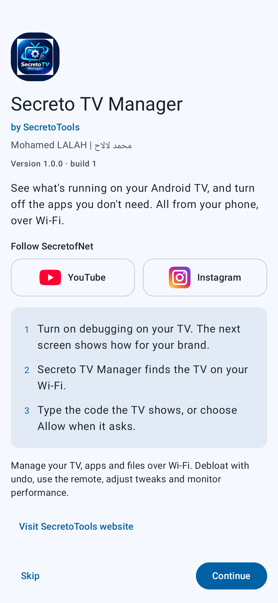
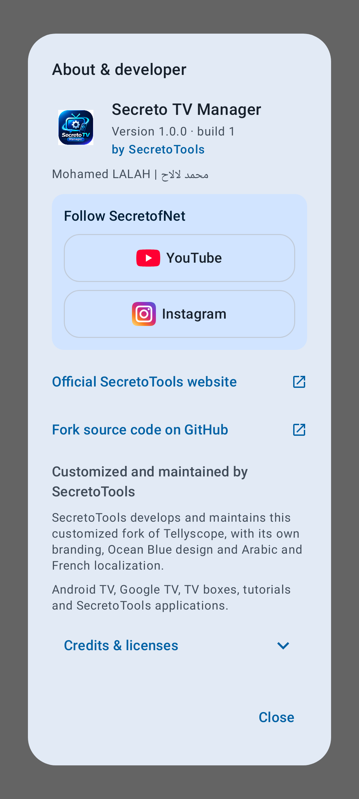

<p align="center">
  
</p>

# Secreto TV Manager

**Android TV and Google TV management from your Android phone.**

Customized and maintained by **SecretoTools / Mohamed LALAH | محمد لالاح**, based on [Tellyscope](https://github.com/man15h/tellyscope) by the Tellyscope contributors. Ocean Blue styling, eight languages and direct access to SecretofNet resources.

[Website](https://secretotools.com) · [YouTube](https://www.youtube.com/@SecretofNet) · [Instagram](https://www.instagram.com/secretofnet/) · [Source](https://github.com/mohamedlalah/SecretoTVManager) · [Report a problem](https://github.com/mohamedlalah/SecretoTVManager/issues)

## Features

- Discover TVs over your local network, pair with wireless debugging or connect using network ADB.
- Use a remote with navigation keys, volume controls, text entry and app shortcuts.
- Review debloat suggestions, disable selected apps and restore changes through history/undo.
- Manage installed apps and install APKs or supported app bundles on the TV.
- Browse and transfer files; inspect storage, CPU, memory and network information.
- Review launcher choices, Private DNS and other supported system tweaks.
- Optional update checks use only this project's official GitHub releases and open a release page. The updater does not automatically download or install APKs.

These tools retain the original project's functionality. Availability depends on the TV, Android/Fire OS version, OEM restrictions and granted ADB access; no universal compatibility is promised.

## Screenshots

<p>
  
  
</p>

These are automated renders from this fork's UI tests, not photographs or captures from the Galaxy A15. The developer reports the signed v1.0.0 APK was physically tested on a Samsung Galaxy A15; YOU-BOX discovery, connection and remote control were also reported working, while those individual tests’ exact build was not identified. File, app, launcher and tweak testing occurred during development. See [device-test evidence](docs/DEVICE_TEST_EVIDENCE.md) for build attribution and limits.

## Requirements and connection

- **Controller phone/tablet:** Android 8.0 (API 26) or newer, as enforced by the app's minSdk. Target/compile SDK is 37; that is not the minimum supported Android version.
- **TV:** Android TV, Google TV or a compatible Android-based TV device exposing ADB. Wireless-debugging pairing requires Android 11+ on the TV. Older/network-ADB support depends on the device; a universal minimum TV version is not verified.
- Phone and TV must be mutually reachable on a trusted local network. Guest Wi-Fi/client isolation, VPNs or firewalls may prevent discovery or connection. No root is required by the app's normal workflow.

1. Enable Developer options on the TV, then enable the debugging option its firmware provides (network/ADB debugging or wireless debugging).
2. Open Secreto TV Manager, use the brand-specific connection guide and select the discovered TV, or enter its IP when appropriate.
3. For wireless debugging, enter the pairing code shown by the TV. For an authorization prompt, verify it refers to your own phone before allowing access.
4. Revoke authorizations and disable debugging when no longer needed. Never authorize an unknown device or expose ADB to the internet.

**ADB grants powerful control over the TV.** Use only devices you own or are authorized to administer, on a network you trust. Pairing codes and device reports may reveal sensitive device/network information; review reports before submitting them.

## Install v1.0.0

Publication is pending final review. Once published, obtain **Secreto-TV-Manager-1.0.0.apk** only from the [official repository's Releases](https://github.com/mohamedlalah/SecretoTVManager/releases). Upstream Tellyscope APKs are a separate application and are not this fork's updates.

1. Verify the APK's SHA-256 against the release notes (or run `sha256sum` on Linux / `shasum -a 256` on macOS).
2. On the Android controller, open the APK and permit installation from that specific browser/file manager if Android requests it. Revoke that permission afterward if you do not need it.
3. Keep future updates on the same trusted signing identity. A debug-signed development installation cannot normally be updated by this release key. Do not uninstall it without first deciding what app data/configuration you need to preserve.

Application ID: `com.secreto.tvmanager` · Version: `1.0.0` · Version code: `1`

APK SHA-256:
```text
f942f5fbe9731656ca4e944d0ce18761db8cf864a7ae7df063c787e164954e23
```

Signing certificate SHA-256:
```text
83d1c238040cc3dca9dbb3fe71ad5468a95eb4aaa09654f6bb7107d36c06ef61
```

## Use system changes carefully

- **Debloat:** review every selected package and model-specific suggestion. Disabling a package can still break TV functions. Keep a recovery route and use history/undo; package uninstallation can remove data and is not equivalent to reversible disabling.
- **Launchers:** verify an alternative opens and provides working navigation before changing Home. Keep a way to restore the TV's launcher. Accessibility permissions grant additional control; enable them only when understood and necessary.
- **DNS:** record the previous settings. A Private DNS provider may see DNS queries; blocking or unreachable DNS can break apps or connectivity. Know how to restore the prior configuration locally on the TV.
- **System settings:** animation, cache, access and other changes can affect apps and usability. Change one thing at a time, read confirmations and verify the result. Undo cannot guarantee recovery from every OEM-specific behavior or data loss.

## Languages

English, العربية, Français, Español, हिन्दी, 日本語, Русский and 简体中文. Arabic RTL is supported. On Android 13+, Android's per-app language setting is available. Translation corrections are welcome.

## Build and validation

The repository includes the Gradle wrapper, app/ADB/CLI modules, TV-helper sources, resource assets, R8 rules, legal bundling and release-preparation scripts. Install an Android SDK with platform 37 and the compatible build tools; configure your SDK locally (never commit local.properties).

```sh
./gradlew :app:assembleDebug
./gradlew :app:assembleRelease       # unsigned when RELEASE_* variables are absent
python3 -m unittest discover -s tests/release -v
```

AGP is 9.4.1, Gradle 9.8.2 and Java source/target is 17. The checked-in daemon criteria select JDK 21. Kadb 2.1.5 contains Java 25 class files: tests loading it require a Java 25 test runtime, so installing JDK 25 or setting JAVA_HOME alone may not override the daemon criteria. With an isolated Java25 test launcher, the full app (701) and ADB (296) suites now pass: 997 tests, zero failures/errors/skips. Running the tests on Java21 still encounters Kadb’s class-version mismatch; the project daemon criteria remain21. See [Java25 verification](docs/JAVA25_VERIFICATION.md) for the exact temporary override and [current release blockers](docs/RELEASE_BLOCKERS_RESOLUTION.md).

Producing an unsigned artifact does not require the official private key. A developer may sign their own build with their own key; it will not update the official signed installation. The private release key/password is never part of corresponding source.

## License, source and credits

Secreto TV Manager is distributed under **GPL-3.0-only**, preserving the original **Copyright (C) 2026 Tellyscope contributors** and their work. SecretoTools / Mohamed LALAH is responsible for this fork's customizations and maintenance, not authorship of the entire original codebase.

- [Full GPL-3.0 license](LICENSE), [original NOTICE and third-party credits](NOTICE), [fork release notice](release/RELEASE_NOTICE.md), [additional dependency license texts](release/licenses/).
- Original project: [man15h/tellyscope](https://github.com/man15h/tellyscope); [original demo](https://youtu.be/N_PeDw5GiCc); [upstream site](https://man15h.github.io/tellyscope/). Original version history is preserved in [CHANGELOG.md](CHANGELOG.md); fork changes are in [SECRETO_CHANGELOG.md](SECRETO_CHANGELOG.md).
- Key dependencies include Kadb/Dadb, spake2-java, AndroidX/Compose/Material, Kotlin/coroutines, Bouncy Castle and the Elisabeth libraries. Device lists are adapted from [cleanyourtv](https://github.com/Gathin23/cleanyourtv) with its MIT attribution. Each retains its applicable license and notices. Service marks identify their owners and imply no endorsement.
- Publish complete corresponding source for the exact binary alongside the release with equivalent download access and at no additional charge. The native-source/build gap is now closed in the [native provenance report](docs/NATIVE_GRAPHICS_PATH.md), and a fresh sanitized local source package is prepared. Java25 host-test validation now passes; the live repository's inherited publishing workflow and exact public-source readiness still block publication; see the [current blocker report](docs/RELEASE_BLOCKERS_RESOLUTION.md). A collection of source JARs alone is not a completeness guarantee.

See the [publication checklist](docs/PUBLICATION_CHECKLIST.md). GitHub Actions currently prepare unsigned review artifacts only; they do not publish releases. Nothing in this README asserts that v1.0.0 has already been published.
