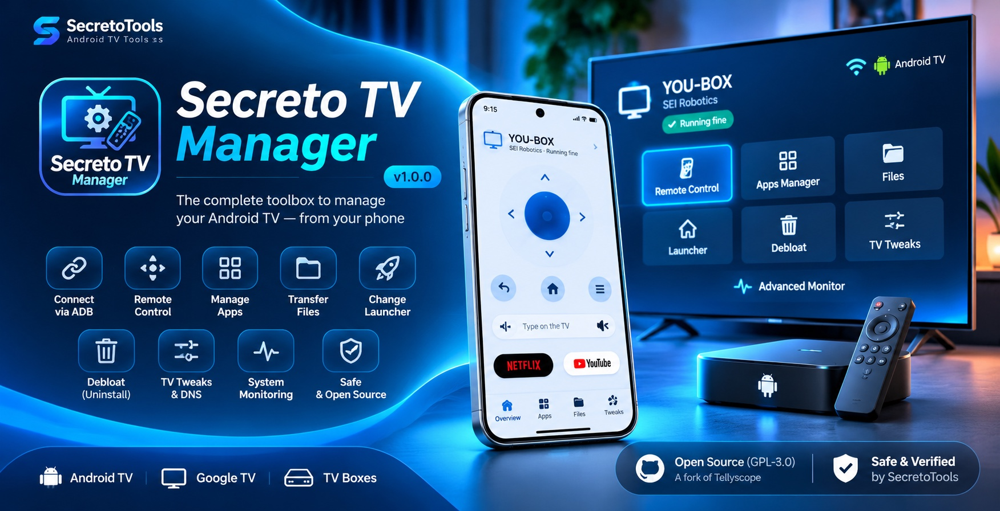

<div align="center">
  
  <h1>Secreto TV Manager</h1>
  <p><strong>Your Android TV, managed from your Android phone or tablet.</strong></p>
  <p>SecretoTools · Mohamed LALAH / محمد لالاح · SecretofNet</p>
  <p>
    <a href="https://github.com/mohamedlalah/SecretoTVManager/releases/tag/v1.0.0"></a>
    <a href="#installation--connection"></a>
    <a href="LICENSE"></a>
    <a href="https://github.com/mohamedlalah/SecretoTVManager/releases/latest"></a>
    <a href="https://www.virustotal.com/gui/file/f942f5fbe9731656ca4e944d0ce18761db8cf864a7ae7df063c787e164954e23/detection"></a>
  </p>
  
  <p><sub>Promotional illustration. Illustrated interfaces are conceptual; authentic application UI renders appear below.</sub></p>
</div>

Manage compatible Android TV and Google TV devices over your trusted local network: connect through ADB, use a remote, manage apps and files, review debloat choices, adjust supported settings and monitor performance. Ocean Blue styling, eight languages and Arabic RTL support.

**v1.0.0 is publicly available.** This SecretoTools fork is based on [Tellyscope](https://github.com/man15h/tellyscope) and distributed under **GPL-3.0-only**, with original credits and notices preserved. Features depend on the TV firmware and authorized ADB access; universal compatibility is not promised.

## Quick links

| Get the app | Learn, verify & connect |
|---|---|
| **[Download APK · v1.0.0 · 3.74 MB](https://github.com/mohamedlalah/SecretoTVManager/releases/download/v1.0.0/Secreto-TV-Manager-1.0.0.apk)** | [Official GitHub Release](https://github.com/mohamedlalah/SecretoTVManager/releases/tag/v1.0.0) |
| [Product page](https://secretotools.com/products/secreto-tv-manager/) · [العربية](https://secretotools.com/ar/products/secreto-tv-manager/) · [Français](https://secretotools.com/fr/products/secreto-tv-manager/) | [SHA-256 checksums](https://github.com/mohamedlalah/SecretoTVManager/releases/download/v1.0.0/SHA256SUMS) · [VirusTotal report](https://www.virustotal.com/gui/file/f942f5fbe9731656ca4e944d0ce18761db8cf864a7ae7df063c787e164954e23/detection) |
| [Source code](https://github.com/mohamedlalah/SecretoTVManager) · [Report an issue](https://github.com/mohamedlalah/SecretoTVManager/issues) | [GitHub Sponsors](https://github.com/sponsors/mohamedlalah) |
| [YouTube · SecretofNet](https://www.youtube.com/@SecretofNet) | [Instagram · SecretofNet](https://www.instagram.com/secretofnet/) |

[Features](#features) · [Screenshots](#screenshots) · [Installation & connection](#installation--connection) · [Security](#security--transparency) · [Safe use](#use-system-changes-carefully) · [Languages](#languages) · [Build](#build-and-validation) · [License & source](#license-source-and-credits) · [Support](#support-development)

## Features

| Tool | What you can do |
|---|---|
| Wireless ADB | Discover a reachable TV, pair through wireless debugging or use supported network ADB. |
| Remote control | Navigate, adjust volume, enter text and open app shortcuts from your phone. |
| Application management | Review installed apps and install APKs or supported app bundles on the TV. |
| File transfer | Browse, send and retrieve files through your authorized TV connection. |
| Debloat & recovery | Review suggestions, disable selected packages and restore supported changes through history/undo. Uninstallation and data loss are not universally reversible. |
| Launcher management | Review alternative launchers and supported Home settings while retaining a recovery route. |
| Performance monitoring | Inspect available CPU, memory, storage and network information. |
| DNS & system tweaks | Review Private DNS and device-dependent system controls. |
| TV screenshots | Capture the TV display where supported and save through Android’s document picker. |
| Optional update checks | Check this fork’s official releases and open a release page; no automatic controller-APK download or installation. |

Android TV, Google TV and other Android-based TV devices vary by Android/Fire OS version, manufacturer restrictions and debugging support. A feature being available in the app does not mean every TV permits it.

## Screenshots

<p>
  
  
</p>

These are automated renders from this fork's UI tests, not photographs or captures from the Galaxy A15. The developer reports the signed v1.0.0 APK was physically tested on a Samsung Galaxy A15; YOU-BOX discovery, connection and remote control were also reported working, while those individual tests’ exact build was not identified. File, app, launcher and tweak testing occurred during development. See [device-test evidence](docs/DEVICE_TEST_EVIDENCE.md) for build attribution and limits.

## Installation & connection

**Install the controller APK on your Android phone or tablet—not on the TV.** The TV is the device you manage.

### Requirements

- **Phone/tablet:** Android 8.0 (API 26) or newer. Target/compile SDK 37 is not the minimum supported Android version.
- **TV:** Android TV, Google TV or a compatible Android-based device exposing ADB. Wireless-debugging pairing requires Android 11+ on the TV; older/network-ADB support depends on the device. A universal minimum TV version is not verified.
- **Network:** phone and TV must be mutually reachable on a trusted local network. Guest Wi-Fi/client isolation, VPNs or firewalls may prevent connection. The app’s normal workflow does not require root.

### Install the official release

1. [Download Secreto-TV-Manager-1.0.0.apk](https://github.com/mohamedlalah/SecretoTVManager/releases/download/v1.0.0/Secreto-TV-Manager-1.0.0.apk) from official GitHub Releases and verify its [checksum](#security--transparency).
2. Open the downloaded APK on the Android phone/tablet.
3. If Android asks to allow installation from your browser or file manager, review the source and allow it only if you trust the download. The website cannot bypass Android security prompts. Revoke that installation permission afterward if you no longer need it.
4. Complete installation and open Secreto TV Manager.
5. Follow the in-app TV connection guide and the authorization steps below.

Keep future updates on the same trusted signing identity. A debug-signed installation cannot normally be updated by the official release key; decide which data/configuration you need to preserve before uninstalling an incompatible build. Upstream Tellyscope APKs are separate from this fork’s releases.

### Connect your TV

1. Enable Developer options on the TV, then the network/ADB or wireless debugging option provided by its firmware.
2. Select a discovered TV in Secreto TV Manager or enter its IP when appropriate; follow the brand-specific connection guide.
3. Enter the TV’s wireless pairing code or verify the authorization prompt refers to your own phone before allowing access.
4. Revoke authorization and disable wireless debugging when finished. Never authorize an unknown device or expose ADB to the internet.

## Security & transparency

The exact signed v1.0.0 APK received **0/68 detections on VirusTotal on November 2, 2026** (analysis time: 22:47:21 UTC). [Read the public report](https://www.virustotal.com/gui/file/f942f5fbe9731656ca4e944d0ce18761db8cf864a7ae7df063c787e164954e23/detection).

Antivirus results reflect the engines and analysis time shown; **they cannot guarantee absolute safety**, rule out every vulnerability or certify all runtime behavior. This is a dated result for this exact file, not a promise about future builds.

| Release identity | Value |
|---|---|
| APK | `Secreto-TV-Manager-1.0.0.apk` |
| Size | **3,742,065 bytes** (3.74 MB decimal) |
| Application ID | `com.secreto.tvmanager` |
| Version | `1.0.0` · code `1` |
| Signing | RSA-4096 certificate; APK v2/v3 signatures verified |

**APK SHA-256**

```text
f942f5fbe9731656ca4e944d0ce18761db8cf864a7ae7df063c787e164954e23
```

Verify locally with `sha256sum Secreto-TV-Manager-1.0.0.apk` (Linux) or `shasum -a 256 Secreto-TV-Manager-1.0.0.apk` (macOS). Compare against the [published SHA256SUMS](https://github.com/mohamedlalah/SecretoTVManager/releases/download/v1.0.0/SHA256SUMS).

**Signing certificate SHA-256**

```text
83d1c238040cc3dca9dbb3fe71ad5468a95eb4aaa09654f6bb7107d36c06ef61
```

**ADB grants powerful control over the TV.** Use only devices you own or are authorized to administer. Keep debugging on a trusted network and revoke access when it is no longer needed. Pairing codes and device reports may reveal private network/device information; review and redact reports before sharing them.

## Use system changes carefully

- **Debloat:** review every selected package and model-specific suggestion. Disabling a package can still break TV functions. Keep a recovery route and use history/undo; package uninstallation can remove data and is not equivalent to reversible disabling.
- **Launchers:** verify an alternative opens and provides working navigation before changing Home. Keep a way to restore the TV's launcher. Accessibility permissions grant additional control; enable them only when understood and necessary.
- **DNS:** record the previous settings. A Private DNS provider may see DNS queries; blocking or unreachable DNS can break apps or connectivity. Know how to restore the prior configuration locally on the TV.
- **System settings:** animation, cache, access and other changes can affect apps and usability. Change one thing at a time, read confirmations and verify the result. Undo cannot guarantee recovery from every OEM-specific behavior or data loss.

## Languages

English, العربية, Français, Español, हिन्दी, 日本語, Русский and 简体中文. Arabic RTL is supported. On Android 13+, Android's per-app language setting is available. Translation corrections are welcome.

## Build and validation

The repository includes the Gradle wrapper, app/ADB/CLI modules, TV-helper sources, resource assets, R8 rules, legal bundling and release-preparation scripts. Install an Android SDK with platform 37 and the compatible build tools; configure your SDK locally (never commit local.properties).

```sh
./gradlew :app:assembleGithubDebug
./gradlew :app:assembleGithubRelease       # unsigned when RELEASE_* variables are absent
python3 -m unittest discover -s tests/release -v
```

AGP is 9.4.1, Gradle 9.8.2 and Java source/target is 17. The checked-in daemon criteria select JDK 21. Kadb 2.1.5 contains Java 25 class files: tests loading it require a Java 25 test runtime, so installing JDK 25 or setting JAVA_HOME alone may not override the daemon criteria. With an isolated Java25 test launcher, the full app (701) and ADB (296) suites now pass: 997 tests, zero failures/errors/skips. Running the tests on Java21 still encounters Kadb’s class-version mismatch; the project daemon criteria remain21. See [Java25 verification](docs/JAVA25_VERIFICATION.md) for the exact temporary override and [historical blocker resolution](docs/RELEASE_BLOCKERS_RESOLUTION.md).

The GitHub debug APK is `app/build/outputs/apk/github/debug/app-github-debug.apk`. The optional `play` flavor excludes GitHub update checks and launcher downloads; both flavors bundle the same legal notices. The current development integration is documented in [the upstream update report](docs/UPSTREAM_V0_16_INTEGRATION.md). The test counts above describe the published v1.0.0 build.

Producing an unsigned artifact does not require the official private key. A developer may sign their own build with their own key; it will not update the official signed installation. The private release key/password is never part of corresponding source.

## License, source and credits

Secreto TV Manager is distributed under **GPL-3.0-only**, preserving the original **Copyright (C) 2026 Tellyscope contributors** and their work. SecretoTools / Mohamed LALAH is responsible for this fork’s customizations and maintenance, not authorship of the entire original codebase.

- [Full GPL-3.0 license](LICENSE), [original NOTICE and third-party credits](NOTICE), [fork release notice](release/RELEASE_NOTICE.md), [source availability information](release/SOURCE_AVAILABILITY.md) and [dependency license texts](release/licenses/).
- Original project: [man15h/tellyscope](https://github.com/man15h/tellyscope); [original demo](https://youtu.be/N_PeDw5GiCc); [upstream site](https://man15h.github.io/tellyscope/). Original history remains in [CHANGELOG.md](CHANGELOG.md); fork changes are in [SECRETO_CHANGELOG.md](SECRETO_CHANGELOG.md).
- Key dependencies include Kadb/Dadb, spake2-java, AndroidX/Compose/Material, Kotlin/coroutines, Bouncy Castle and the Elisabeth libraries. Device lists are adapted from [cleanyourtv](https://github.com/Gathin23/cleanyourtv) with its MIT attribution. Each retains its applicable license and notices. Service marks identify their owners and imply no endorsement.

The [published v1.0.0 release](https://github.com/mohamedlalah/SecretoTVManager/releases/tag/v1.0.0) provides corresponding source and legal materials alongside the binary, with equivalent public download access:

| Release material | Purpose |
|---|---|
| [Project source](https://github.com/mohamedlalah/SecretoTVManager/releases/download/v1.0.0/Secreto-TV-Manager-1.0.0-project-source.tar.gz) | Release project snapshot, build scripts, resources and notices. |
| [Dependency source](https://github.com/mohamedlalah/SecretoTVManager/releases/download/v1.0.0/Secreto-TV-Manager-1.0.0-dependency-source.tar.gz) | Published dependency sources, inventory and compatibility mapping. |
| [Native source](https://github.com/mohamedlalah/SecretoTVManager/releases/download/v1.0.0/Secreto-TV-Manager-1.0.0-native-source.tar.gz) | AndroidX graphics-path source, original build context and provenance. |
| [Legal materials](https://github.com/mohamedlalah/SecretoTVManager/releases/download/v1.0.0/Secreto-TV-Manager-1.0.0-legal.tar.gz) | Original bundled license and notice texts. |
| [Provenance](https://github.com/mohamedlalah/SecretoTVManager/releases/download/v1.0.0/PROVENANCE.json) · [Build information](https://github.com/mohamedlalah/SecretoTVManager/releases/download/v1.0.0/SOURCE_AND_BUILD.md) | Recorded artifact/source relationship and build requirements. |

A collection of source JARs alone is not a completeness guarantee. See the [native provenance report](docs/NATIVE_GRAPHICS_PATH.md). Official private signing keys are not distributed and are not required to build your own version. Independent bit-for-bit reproduction is not claimed.

### Technical documentation & release history

[Java 25 verification](docs/JAVA25_VERIFICATION.md) · [Device-test evidence](docs/DEVICE_TEST_EVIDENCE.md) · [Update-system verification](docs/UPDATE_SYSTEM_VERIFICATION.md) · [Publication checklist](docs/PUBLICATION_CHECKLIST.md)

The [final pre-release audit](docs/FINAL_RELEASE_AUDIT.md), [blocker resolution report](docs/RELEASE_BLOCKERS_RESOLUTION.md) and [staged publication plan](docs/STAGED_PUBLICATION_PLAN.md) are historical preparation records. Their earlier pending-publication statements do not describe today’s status: **v1.0.0 is published**. Original reports are retained rather than rewritten. GitHub Actions do not automatically sign or publish releases; the preparation workflow produces unsigned review materials only.

## Support development

If Secreto TV Manager helps you, you can voluntarily [support Mohamed LALAH / SecretoTools through GitHub Sponsors](https://github.com/sponsors/mohamedlalah). Sponsorship is **not required** to download or use the application.

For help or reproducible bug reports, use [GitHub Issues](https://github.com/mohamedlalah/SecretoTVManager/issues). Follow [SecretofNet on YouTube](https://www.youtube.com/@SecretofNet) and [Instagram](https://www.instagram.com/secretofnet/), or visit [SecretoTools](https://secretotools.com).
